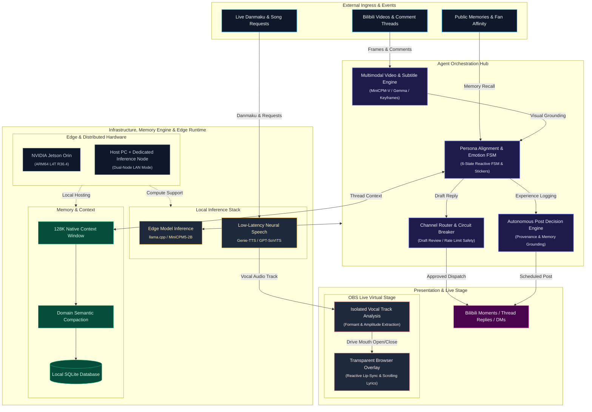

# Tuber Studio

<p align="center">
  <a href="https://github.com/4everWZ/Tuber_Studio"></a>
  <a href="https://python.org"></a>
  <a href="https://developer.nvidia.com/embedded/jetson-modules"></a>
  <a href="https://fastapi.tiangolo.com"></a>
  <a href="https://github.com/4everWZ/Tuber_Studio/blob/main/LICENSE"></a>
</p>

<p align="center">
  <b>English</b> · <a href="README.zh-CN.md">简体中文</a>
</p>

---

<p align="center">
  
  &nbsp;&nbsp;&nbsp;&nbsp;&nbsp;&nbsp;
  
  &nbsp;&nbsp;&nbsp;&nbsp;&nbsp;&nbsp;
  
</p>
<p align="center">
  <sub>Built-in character: Da-Fei-Yu (Chibi whale-girl, adapted from YunYueSama's open-source artwork)</sub>
</p>

Tuber Studio is a self-hosted AI character operations workbench for community engagement (e.g. Bilibili comments) and local virtual stage performances. It supports multimodal video and comment understanding, custom persona and voice cloning, experimental autonomous social posting, and an OBS browser overlay. Designed to run on consumer PCs or NVIDIA Jetson Orin edge devices.

---

## Features

- **Multimodal Comments & DM Workspace:** Video frame understanding and subtitle parsing; parses threaded comment discussions and analyzes sentiment. Drafts use human review by default, with editing, account-based publishing, and optional automatic browsing and replies. Supports routing sensitive topics to private direct messages while tracking user interaction history.
- **Character Profiles & Voice Cloning:** Customize persona rules, speaking style, and sticker galleries. Includes the built-in "Da-Fei-Yu" preset with versioning, and supports GPT-SoVITS and Genie-TTS reference audio bindings.
- **Autonomous Posts (Experimental):** Allows the character to decide when and what to post based on accumulated public memories. Generated content maintains provenance tracking to isolate fictional backstories from objective facts, accompanied by rate limiting and emergency stop controls.
- **Virtual Stage & Audio Lip-Sync:** Transparent browser overlay for OBS with draggable component staging. Drives mouth open/close animations using amplitude and formant analysis from an isolated vocal track; includes local music playback, request queues, and timed lyrics.
- **Edge Deployment & Dual-Node Setup:** Pre-configured for NVIDIA Jetson Orin (ARM64 L4T R36.4) via Docker; also supports running the Web UI and OBS on a primary PC while offloading model inference to a secondary computer over the local network.
- **Context & Storage:** Configurable 128K context window with domain-specific semantic compaction to preserve long-term interaction history. Data is stored locally in SQLite for full privacy.

---

## System Architecture



---

## Quick Start

### Option A: NVIDIA Jetson Edge Device (Recommended ARM64 L4T R36.4)

Requires Docker with the NVIDIA Container Runtime. Run as a regular user with Docker privileges:

```bash
curl -fsSL https://raw.githubusercontent.com/4everWZ/Tuber_Studio/main/tools/jetson/run-ready.sh -o run-ready.sh
bash run-ready.sh --data ./tuber-data
```

The launcher will pull `ghcr.io/4everwz/tuber_studio:r36.4`, download the required models, and prepare the default voice.  
Open [http://127.0.0.1:9020](http://127.0.0.1:9020) and sign in using the administrator token in `tuber-data/admin-token`.

---

### Option B: Local Development (Windows / Linux / macOS)

Requires **Python 3.12** and **[uv](https://docs.astral.sh/uv/)**:

```bash
# 1. Install dependencies
uv sync --python 3.12

# 2. Start the service
uv run python -m tuber_studio
```

Open [http://127.0.0.1:8020](http://127.0.0.1:8020). The administrator token is located in `runtime/admin-token`. Configure local llama.cpp endpoints, TTS providers, or OpenAI-compatible APIs in the **Settings** menu.

---

### Option C: Dual-Node Deployment

For setups where inference requirements are heavy, the Web UI and OBS player can run on a primary PC, while model inference is handled by an idle GPU computer or Jetson over the local area network. See the [Deployment Guide](docs/guides/deployment.md) for network details.

---

## Character States

The built-in character "Da-Fei-Yu" includes 6 pre-configured animation states:
- **Idle**: Resting breath rhythms and blinking animations
- **Talking**: Lip movement during TTS speech or chat interactions
- **Cheerful**: Triggered by positive feedback or high affinity
- **Confused**: Complex reasoning or channel evaluation
- **Angry**: Triggered by criticism or playful banter
- **Gift**: Celebration state upon receiving gifts or donations

To create a custom character (OC), use the "Character Profiles" menu to customize personality rules, replace sprite images, and bind custom voice profiles. See the [Original Character Guide](docs/guides/characters.md).

---

## Documentation

- [Deployment, Updates, and Network Configuration](docs/guides/deployment.md)
- [Create an Original Character (OC)](docs/guides/characters.md)
- [Comments and Autonomous Posting](docs/guides/operations.md)
- [Live Workspace and OBS Setup](docs/guides/live.md)
- [Context and Compaction Specification](docs/specs/context-and-compaction.md)
- [CI and ARM64 Image Builds](https://github.com/4everWZ/Tuber_Studio/actions/workflows/ci.yml)

---

## Roadmap

- [ ] Real-time danmaku adapters for live streams (Bilibili / Douyin)
- [ ] Pluggable singing voice model interface (Singing Voice Conversion)
- [ ] Real-time gameplay screen capture and companion commentary
- [ ] Multi-character co-hosting mechanics

---

## Acknowledgements

Built with MiniCPM, llama.cpp, GPT-SoVITS, and Genie-TTS. Third-party terms are available in the [Genie-TTS license](third_party/Genie-TTS/LICENSE), [Codex license](third_party/openai-codex/LICENSE), and [Codex notices](third_party/openai-codex/NOTICE).

Q-style artwork by [YunYueSama](https://github.com/YunYueSama/codex-deepseek-pet), adapted into six GIF states under the [upstream asset terms](third_party/whale-avatar/UPSTREAM.md). Other artwork and voice asset sources are recorded in the [asset manifest](assets/whale/manifest.json) and [voice profiles](config/voices.json).
