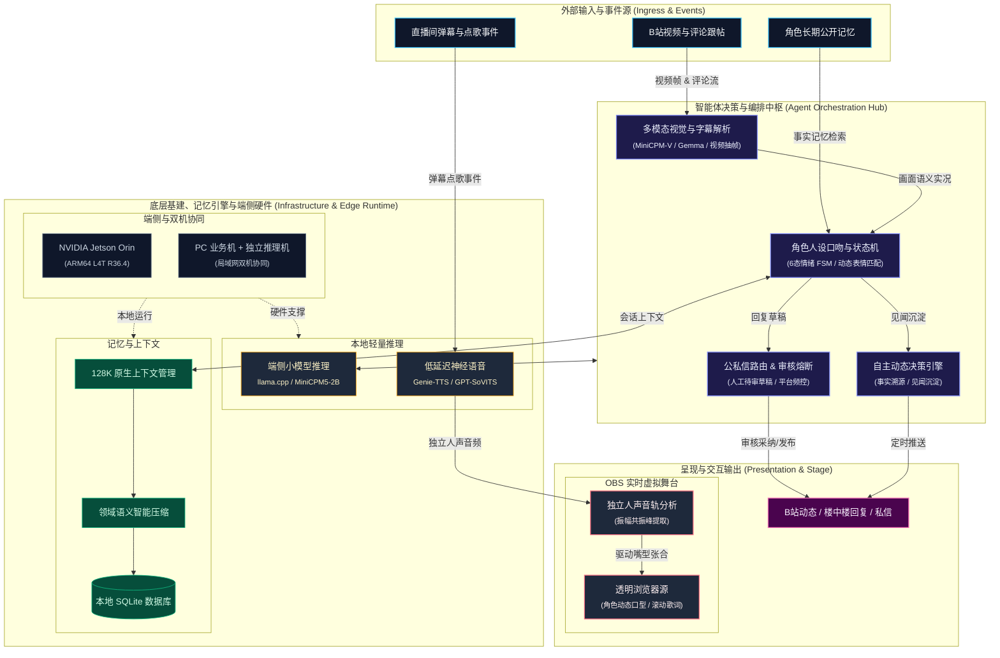

# Tuber Studio

<p align="center">
  <a href="https://github.com/4everWZ/Tuber_Studio"></a>
  <a href="https://python.org"></a>
  <a href="https://developer.nvidia.com/embedded/jetson-modules"></a>
  <a href="https://fastapi.tiangolo.com"></a>
  <a href="https://github.com/4everWZ/Tuber_Studio/blob/main/LICENSE"></a>
</p>

<p align="center">
  <a href="README.md">English</a> · <b>简体中文</b>
</p>

---

<p align="center">
  
  &nbsp;&nbsp;&nbsp;&nbsp;&nbsp;&nbsp;
  
  &nbsp;&nbsp;&nbsp;&nbsp;&nbsp;&nbsp;
  
</p>
<p align="center">
  <sub>内置示例角色：大肥鱼（Q版鲸鱼娘，形象源自 YunYueSama 开源项目）</sub>
</p>

Tuber Studio 是一个面向 B站评论运营与本地虚拟舞台演出的自部署 AI 角色工作台。支持多模态视频与评论理解、原创角色设定与声音克隆、实验性自主动态发布，以及可在 OBS 中直接使用的虚拟直播播放器。支持在普通电脑或 NVIDIA Jetson Orin 边缘计算设备上运行。

---

## 核心功能

- **多模态评论与私信工作台：** 支持视频抽帧理解与字幕解析，按楼层结构化组织多轮跟帖并分析反馈。默认采用人工审核草稿模式，支持编辑、一键采纳或通过配置的账号发布，亦可设置自动浏览与回复。支持根据议题敏感度将对话引导至私信，并记录粉丝 UID 互动阶段。
- **角色配置与声音克隆：** 支持自定义角色人设、口吻、回复规则与表情包图库。内置大肥鱼预设角色，支持接入 GPT-SoVITS 或 Genie-TTS 参考音频绑定专属音色，具备版本管理能力。
- **自主动态发布（实验性）：** 角色可根据公开记忆与互动沉淀，自主决定发布内容与时机。正文生成关联事实来源追踪，区分背景设定与客观记录，支持发布频控与一键全局熔断。
- **虚拟舞台与音频驱动口型：** 提供基于透明背景的 OBS 浏览器源播放器，支持场景组件拖拽编排。通过提取独立人声音轨分析振幅与共振峰，驱动角色口型开合；内置本地曲库、点歌队列与同步歌词。
- **端侧部署与双机协同：** 适配 NVIDIA Jetson Orin (ARM64 L4T R36.4) 容器环境；支持将 Web 管理与推流放在日常电脑、将模型推理运行在局域网内其他 GPU 主机的双机协同模式。
- **上下文管理与数据存储：** 默认提供 128K 上下文支持，内置按领域的语义压缩策略，长期互动不丢失关键记忆；所有数据均保存在本地 SQLite，保障数据隐私。

---

## 系统架构



---

## 快速上手

### 方式一：NVIDIA Jetson 设备 (推荐 ARM64 L4T R36.4)

要求安装 Docker 与 NVIDIA Container Runtime。使用具有 Docker 权限的用户执行：

```bash
curl -fsSL https://raw.githubusercontent.com/4everWZ/Tuber_Studio/main/tools/jetson/run-ready.sh -o run-ready.sh
bash run-ready.sh --data ./tuber-data
```

脚本会拉取 `ghcr.io/4everwz/tuber_studio:r36.4` 容器镜像，首次启动会自动下载所需模型并准备默认音色。  
启动后访问 [http://127.0.0.1:9020](http://127.0.0.1:9020)，管理员令牌保存在 `tuber-data/admin-token`。

---

### 方式二：本地开发运行 (Windows / Linux / macOS)

环境要求：**Python 3.12** 与 **[uv](https://docs.astral.sh/uv/)**。

```bash
# 1. 安装依赖
uv sync --python 3.12

# 2. 启动服务
uv run python -m tuber_studio
```

启动后访问 [http://127.0.0.1:8020](http://127.0.0.1:8020)，管理员令牌在 `runtime/admin-token`。可在「设置」中配置本地 llama.cpp、TTS 或兼容 OpenAI 协议的模型端点。

---

### 方式三：双机协同部署

当推理模型开销较大时，可将 Web 界面与 OBS 播放器运行在日常使用的电脑上，而将推理服务部署在局域网内的独立主机或 Jetson 上。具体网络与端口配置详见 [部署指南](docs/guides/deployment.md)。

---

## 角色状态说明

内置角色「大肥鱼」提供 6 种预设动画状态：
- **待机 (Idle)**：基础呼吸律动与眨眼
- **说话 (Talking)**：语音播报与回复互动时的口型动作
- **开心 (Cheerful)**：收到互动好评或触发正面情绪
- **思考 (Confused)**：复杂推理与渠道判断
- **生气 (Angry)**：遇到不友好评论或被调侃时的情绪反馈
- **感谢 (Gift)**：收到礼物或打赏动效

如需创建自定义角色（OC），可在系统界面的「角色配置」中自定义人设规则、替换贴图与绑定音色，详见 [原创角色指南](docs/guides/characters.md)。

---

## 文档索引

- [部署、更新与网络配置指南](docs/guides/deployment.md)
- [创建与定制原创角色 (OC)](docs/guides/characters.md)
- [评论抓取、审核与自主动态运营](docs/guides/operations.md)
- [直播工作台与 OBS 播放器使用指南](docs/guides/live.md)
- [上下文管理与语义压缩规范](docs/specs/context-and-compaction.md)
- [CI 与 ARM64 镜像构建](https://github.com/4everWZ/Tuber_Studio/actions/workflows/ci.yml)

---

## 路线图 (Roadmap)

- [ ] 抖音、B站真实直播间弹幕双向实时适配器
- [ ] 可拔插歌唱推理模型接口接入（Singing Voice Conversion）
- [ ] 游戏画面实时捕获与解说互动
- [ ] 多角色同台互动机制

---

## 致谢与开源协议

本项目由 MiniCPM, llama.cpp, GPT-SoVITS 与 Genie-TTS 等开源项目赋能构建。第三方开源条款见 [Genie-TTS 许可证](third_party/Genie-TTS/LICENSE)、[Codex 许可证](third_party/openai-codex/LICENSE) 和 [Codex 声明](third_party/openai-codex/NOTICE)。

Q 版形象原作作者为 [YunYueSama](https://github.com/YunYueSama/codex-deepseek-pet)，本项目将图集转换为六种透明 GIF 状态，详见 [素材条款与修改说明](third_party/whale-avatar/UPSTREAM.md)。其他形象和音色来源见 [素材清单](assets/whale/manifest.json) 和 [音色配置](config/voices.json)。
