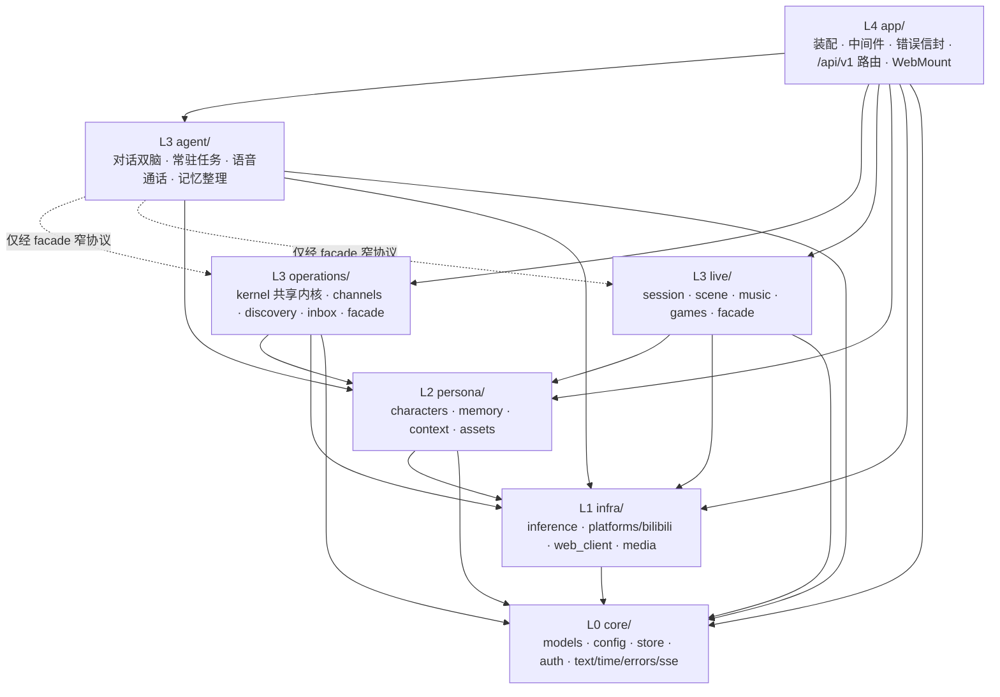
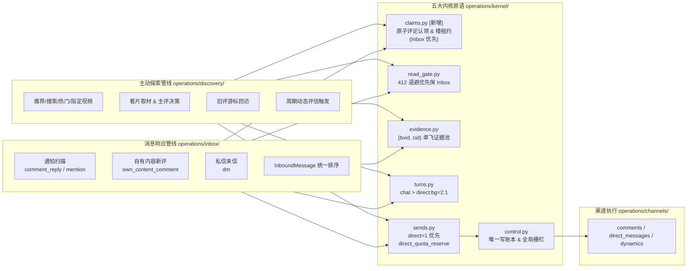

# 全仓分层重构与运营双管线架构蓝图

本文档确立 Tuber Studio 从当前原型演进目录向**全仓库分层架构**与**阶段二运营双管线**合并演进的技术蓝图、模块边界、接口契约、迁移路线及自动化守卫机制。

- **适用范围：** 后端 `src/tuber_studio/`、前端 `frontend/`、测试 `tests/`、评测 `evaluations/` 及对应构建部署配置 `deploy/`、`tools/`。
- **推进原则：** 在 M0 提交 Batch 1 已验收基线与本蓝图后，将全仓分层重构与阶段二（运营共享内核 + 主动探索 Discovery / 消息响应 Inbox 双管线）合并推进至 M5 闭环。阶段四（工作站正式业务库备份归档与容器上线）在本蓝图 M0–M5 全部里程碑验收通过后单独执行。

---

## 一、背景与现状诊断

### 1.1 已验证的前置经验

在 Batch 1（阶段一与阶段三复验）中，`src/tuber_studio/agent/` 围绕「前台表达脑 + 后台路由脑」落地了局部严格分层（`chat_models` L0 → `chat_context` L2 → `front_dialogue` L2a / `turn_router` L2b / `capability_dispatcher` L3 → `chat_transport` L1 → `operator_chat` 薄装配门面），并在工作站隔离回放中取得 `39 / 39` 路由准确率、前台 prompt tokens 下降 `49.4%–56.9%` 及重启恢复 `15 / 15` 浏览器验收通过。这一实践证明了**按职责单向分层、分离协议与传输、隔离后台工具执行**对稳定性与可测性的决定性价值。

### 1.2 全仓结构性痛点基线

盘点当前主线代码库（以 M0 提交前快照为准），存在五类制约阶段二演进与长期维护的结构性负债：

1. **根目录平铺堆叠：** `src/tuber_studio/` 根目录下聚集了 **78 个 `.py` 文件**（不含子包），`core` 数据模型、推理传输、B 站账号、记忆服务、评论／私信／动态渠道与 FastAPI 应用入口混处同一命名空间，无法阻止跨层反向引用。
2. **超千行巨文件集中：** 全仓存在 **12 个超过 1,000 行的单文件模块**（最大达 `2,694` 行），将状态机、SQLite 仓储、平台同步、模型提示组装与发布事务耦合在一起，单点改动极易波及全链路。
3. **凭据与运行控制权倒置：** `comments.py` 直接持有 `bilibili-credentials.json` 与 `BrowsingAdapter` 构造逻辑并被 `BilibiliAccount` 及 `app.py` 反向包装，导致本应属于基础设施层的账号身份／凭据被业务渠道层锁定；`operations/browsing/service.py` 同时承担共享内核调度、主动看片探索与通知／互动响应，难以独立启停与让路。
4. **前端与 HTTP 契约失配：** `src/tuber_studio/web/` 下散落 4 个 HTML 入口、20 个静态片段页（`pages/*.html`）与几十个原生 JS 模块，缺少类型系统、构建管线与单元测试；后端 17 个路由文件分散定义 **210 条 `/api/*` 路由**，尚未统一前缀、响应模型与错误信封。
5. **测试互导掩盖边界：** `tests/` 根目录存在 206 个测试文件，其中 **68 个文件（合计 168 条导入语句）** 直接通过 `from test_* import ...` 互导内部桩与辅助函数，导致测试集与业务模块间形成隐式耦合网。

---

## 二、11 项核心架构决策

| 编号 | 决策主题 | 核心裁定 |
| --- | --- | --- |
| D1 | 治理范围 | **全仓库同构治理**：覆盖后端 `src/tuber_studio/`、前端 `frontend/`、测试 `tests/`、评测 `evaluations/`，同步调整 `deploy/` 与 `tools/` 入口引用。 |
| D2 | 推进节奏 | **先基线后重构、合并阶段二**：M0 提交 Batch 1 基线与蓝图 → M1–M5 合并完成全仓分层重构与阶段二双管线 → 全部里程碑验收闭环后再单独实施阶段四正式库归档与工作站上线。 |
| D3 | 后端分层 DAG | **混合分层 + 严格单向有向无环图（DAG）**：`L0 core/ → L1 infra/ → L2 persona/ → L3 {operations, live, agent}/ → L4 app/`；根目录仅留 `__init__.py`、`__main__.py` 及 gitignored 的 `web_dist/`。 |
| D4 | 零旧文件垫片 | **Clean Break**：仅 `tuber_studio.app`（`app/__init__.py`）保留暴露 `create_app`，维持 `python -m tuber_studio` 与 `uvicorn tuber_studio.app:create_app` 兼容；其余模块、测试、评测与脚本直接迁移新路径，禁止留置 `re-export` 垫片。 |
| D5 | 巨文件拆细 | **全仓 12 个超千行热点彻底拆分**：所有热点文件按单一职责拆解为高内聚子包，单文件职责清晰、可读可控。 |
| D6 | 阶段二双管线 | **共享内核 + 双管线解耦**：在 `operations/kernel/` 下沉五大内核原语（含新增原子认领与楼级租约 `claims.py`），拆出 `discovery/`（主动探索）与 `inbox/`（消息响应），支持单开 Inbox 24h 值守、风控退避优先保消息及 `direct_quota_reserve` 额度保护；数据库与配置严格无损增量迁移，升级默认关闭自动开关。 |
| D7 | 前端工程化 | **独立现代前端工程**：顶层 `frontend/` 采用 `pnpm + Vite + React 19 + TypeScript + CSS Modules + TanStack Query + Vitest/RTL`，保留 4 个独立入口并适配 `<base href>` 子路径挂载，构建输出至 gitignored `src/tuber_studio/web_dist/` 供 FastAPI 与 Docker `web-build` 阶段使用；覆盖全部 20 页及双控制卡、来源标注与队列审核重写。 |
| D8 | API v1 与契约 | **统一 `/api/v1/*` 与 OpenAPI 类型生成**：210 条 API 路由收敛至 `/api/v1/{system,persona,operations,live,agent}/...`，统一 `{code, message, details}` 错误信封；全量 Pydantic 模型经 OpenAPI 导出至前端 `openapi-typescript` 生成 `schema.d.ts`；仅保留非 API 页面、媒体、健康检查与 WS 原入口，不做旧 `/api/*` 双写。 |
| D9 | 测试评测同构 | **按分层重构测试并保留成果路径**：`tests/` 按 `conftest.py`、`architecture/`、`support/`、`core/`..`app/`、`e2e/`、`fixtures/` 组织，消除 68 个文件间的 `test_*` 互导；`evaluations/` 按域整理脚本，**原样保留 `evaluations/results/` 与 `evaluations/cases/` 路径**。 |
| D10 | 自动化守卫 | **零依赖 AST + ESLint 硬门禁**：Python AST 守卫测试直接纳入 `pytest` 与 CI，前端 ESLint 边界规则纳入前端检查，硬拦截反向跨层、循环依赖、`discovery↔inbox` 直连、越过门面直访与根目录新文件回流。 |
| D11 | 分阶段里程碑 | **M0–M5 递进交付与独立验收门禁**：每一里程碑均绑定明确的代码交付范围、自动化检查与真实行为/隔离实机验收门槛，不得带病跨阶段。 |

---

## 三、后端混合分层与严格单向依赖 DAG

### 3.1 分层拓扑与依赖规则

后端 `src/tuber_studio/` 采用五层混合架构（基础共性按技术层次垂直分层，L3 业务域按领域水平隔离并通过窄门面协作）：



**刚性依赖铁律（由 AST 守卫强制执行）：**

| 源层 / 模块 | 允许直接导入 | 严禁导入 |
| --- | --- | --- |
| `L0 core/` | Python 标准库、纯第三方基础库（Pydantic、httpx 类型/基础等） | `infra`、`persona`、`operations`、`live`、`agent`、`app` |
| `L1 infra/` | `core` | `persona`、`operations`、`live`、`agent`、`app` |
| `L2 persona/` | `core`、`infra` | `operations`、`live`、`agent`、`app` |
| `L3 operations/` | `core`、`infra`、`persona`、`operations` 内部允许路径 | `live`、`agent`、`app` |
| `L3 live/` | `core`、`infra`、`persona`、`live` 内部允许路径 | `operations`、`agent`、`app` |
| `L3 agent/` | `core`、`infra`、`persona`、`operations.facade`、`live.facade` | `operations` 非门面子包、`live` 非门面子包、`app` |
| `L4 app/` | `L0`–`L3` 公开入口与路由注册 | 被任何下层 `L0`–`L3` 模块反向导入 |
| `operations/discovery/` | `operations/kernel`、`operations/channels`、`core`、`infra`、`persona` | `operations/inbox` |
| `operations/inbox/` | `operations/kernel`、`operations/channels`、`core`、`infra`、`persona` | `operations/discovery` |
| `src/tuber_studio/` 根目录 | 仅允许 `__init__.py`、`__main__.py`（及 gitignored 构建目录 `web_dist/`） | 禁止新增或保留任何其他 `.py` 业务文件 |

> [!IMPORTANT]
> **跨域协调原则：** `operations` 与 `live` 之间如果需要状态互知（例如直播繁忙时推迟动态或主动浏览评估、直播结束后的台词交接），**严禁互导**；统一由 `L0 core` 定义轻量协议/状态回调接口，或由 `L4 app/lifespan.py` 在装配期注入只读探针与事件回调。同理，`agent` 对 `operations` 或 `live` 的读取与操作必须经由 `operations/facade.py` 与 `live/facade.py` 定义的显式窄协议与 DTO。

### 3.2 后端目标目录树

```text
src/tuber_studio/
├── __init__.py                        # 包标识与版本元信息
├── __main__.py                        # CLI 启动入口（调用 tuber_studio.app:create_app）
├── web_dist/                          # [gitignored] Vite 构建产出，供 app 静态挂载
├── prompts/                           # 提示词模板资源（compact.md 等）
│
├── core/                              # [L0] 零域依赖底座
│   ├── __init__.py
│   ├── config.py                      # Settings、deployment_profiles 配置解析与原子写
│   ├── store.py                       # SQLite Store、事务封装、基础 Schema 与 KV
│   ├── models.py                      # StrictModel、通用校验与基础领域枚举/DTO
│   ├── errors.py                      # 通用业务异常与发布/额度错误定义
│   ├── auth.py                        # AuthSessions、管理令牌与签名校验
│   ├── authority.py                   # 单活业务写锁 acquire_business_writer
│   ├── retention.py                   # 对话与业务数据留存策略
│   ├── sse.py                         # SSE 事件编码器
│   ├── text.py                        # 运营正文校验、敏感/内部引用清洗
│   └── meter.py                       # 通用调用预算、token 计量与窗口辅助
│
├── infra/                             # [L1] 外部服务、平台与受控 IO 适配
│   ├── inference/                     # Omni Chat/Responses/Video/Voice 网关与校验
│   │   ├── http_api.py                # 网关端点校验、重试与队列背压（InferenceQueueBusy）
│   │   ├── providers.py               # Chat/Voice Provider 抽象与错误脱敏
│   │   ├── api_providers.py           # Omni 流式文本与图像校验
│   │   ├── responses_provider.py      # 后台 Responses 客户端与思考预算控制
│   │   ├── omni_speech.py             # 参考朗读与音频能力接口
│   │   ├── video_vision.py            # 视频帧读取与视觉理解协议实现
│   │   ├── video_vision_service.py    # 视觉 Provider 装配与准入恢复
│   │   ├── diagnostics.py             # Provider 诊断与模型卡窗口探针
│   │   └── validation.py              # 推理载荷、音频与结构化输出校验
│   ├── platforms/
│   │   └── bilibili/                  # B 站协议与账号凭据唯一下沉边界
│   │       ├── account.py             # 唯一持有凭据读写、登录态核验与账号身份快照（自 comments.py 剥离）
│   │       ├── login.py               # BilibiliPassport 二维码与 Cookie 续期
│   │       ├── client.py              # 基础 HTTP 客户端、风控码识别与错误映射
│   │       ├── browsing.py            # 视频元数据、字幕、搜索与推荐读取
│   │       ├── comments.py            # 评论区拉取与发送协议
│   │       ├── dynamics.py            # 动态读取、发布与原地修订协议
│   │       ├── messages.py            # 私信会话拉取与文字/图片发送协议
│   │       ├── frames.py              # 故事板与封面拉取
│   │       ├── stream_frame.py        # DASH HTTP Range 流帧精查解码
│   │       ├── images.py              # 图片上传与图床协议
│   │       └── reconciliation.py      # 平台只读核对协议
│   ├── web_client/                    # 公开网页阅读受限客户端（fetch、search、chromium worker）
│   └── media/                         # MediaCache 容量池、软链安全检查与维护清理
│
├── persona/                           # [L2] 角色、记忆、上下文与共有素材
│   ├── characters/                    # 角色卡 CRUD、预设升级、Front Persona、Pets 外观与参考图
│   ├── memory/
│   │   ├── core_memory.py             # 基础记忆与槽位缺失判定
│   │   ├── relationships.py           # 跨渠道好感与用户档案（按账号+UID+OC 隔离）
│   │   ├── sources.py                 # 记忆来源索引、公开授权与撤权状态
│   │   ├── owner_memory.py            # 号主显式偏好与跨端记忆读写
│   │   └── daily/                     # [拆自 daily_memory.py (1,425)]
│   │       ├── models.py
│   │       ├── repository.py
│   │       ├── scoring.py
│   │       ├── organizer_bridge.py
│   │       └── service.py
│   ├── context/                       # 上下文窗口管理、压缩（compaction）、摘要与字幕呈现
│   └── assets/                        # 共享表情包图库、GIF 转换、选图、配图策略与工坊生图
│
├── operations/                        # [L3] 自主运营域（禁止导入 live / agent）
│   ├── facade.py                      # 唯一对 agent/app 暴露的运营状态、查询与任务入队窄门面
│   ├── kernel/                        # 阶段二五大共享内核原语
│   │   ├── control.py                 # OperationsControl：唯一写账本 + 急停/401/切卡/review/uncertain 栅栏
│   │   ├── claims.py                  # [新增] operation_claims 原子评论认领与楼级串行租约（Inbox 优先）
│   │   ├── sends.py                   # OperationSends：direct=1 优先队列 + direct_quota_reserve 额度保护
│   │   ├── turns.py                   # OperationTurns：chat 最高优 + direct:background=2:1 调度车道
│   │   ├── read_gate.py               # 读取节流与 412/429 退避门控（风控优先停探索保消息）
│   │   ├── evidence.py                # (bvid, cid) 单飞证据池与缓存复用
│   │   ├── quotas.py                  # 业务日观看/单视频回复计数与账号滚动窗口
│   │   ├── continuations.py           # 运营生成断点与检查点恢复
│   │   ├── revisions.py               # 平台拒绝后的授权一次性修订票据
│   │   └── feedback.py                # 正文生成包装、诊断与回复去重校验
│   ├── channels/                      # 渠道执行原语（供 discovery 与 inbox 共用）
│   │   ├── comments/                  # [拆自 comments.py (1,476)]
│   │   │   ├── repository.py          # comments/drafts/comment_tasks/publish_attempts 事务仓储
│   │   │   ├── scanner.py             # 手动/按 BV 导入、工作台队列与分类
│   │   │   ├── drafter.py             # 评论素材组装、引用校验与拟稿
│   │   │   └── publisher.py           # 评论发布、审核修订与回执核对
│   │   ├── direct_messages/           # [拆自 direct_messages.py (2,694)]
│   │   │   ├── models.py              # MessagePolicy、IncomingMessage、Window 状态模型
│   │   │   ├── repository.py          # dm_threads/dm_messages/dm_drafts 仓储与私域隔离
│   │   │   ├── sync.py                # 来信拉取、去重与历史水位线
│   │   │   ├── windowing.py           # 同人连续来信合并与会话刷新
│   │   │   ├── drafter.py             # 主动邀约校验、条件约定唤醒与拟稿
│   │   │   └── settlement.py          # 单图/图文两步发送、号主代回结算与对账
│   │   ├── dynamics/                  # [拆自 dynamics.py (2,353)]
│   │   │   ├── repository.py          # dynamic_posts 仓储与去重载荷哈希
│   │   │   ├── evaluator.py           # 公开素材取材、感想方向读取与独立评估节奏
│   │   │   ├── drafter.py             # 动态文案拟稿与来源公开性校验
│   │   │   ├── attachments.py         # 评论互动附图卡片与多图快照绑定
│   │   │   └── publisher.py           # 动态发布、原地修订与 publish_uncertain 对账
│   │   └── attachments/               # 跨渠道配图快照、引用与表情包绑定
│   ├── discovery/                     # 主动探索管线（严禁直连 inbox）
│   │   ├── runner.py                  # 探索轮次调度器、独立开关与进度推进
│   │   ├── batches.py                 # 候选合并、批次计划校验与执行
│   │   ├── repository.py              # 探索批次、视频进度与任务租约仓储
│   │   ├── decisions/                 # [拆自 decisions.py (1,555)]
│   │   │   ├── video_decision.py      # 看片兴趣、主评与补看决策
│   │   │   ├── comment_decision.py    # 楼内评论评估与行动选择
│   │   │   ├── dynamic_trigger.py     # 观看/评论进展向动态评估的节流投递
│   │   │   └── explanation.py         # 决策解释与理由规范化
│   │   ├── comments/                  # [拆自 comment_reader.py (1,102)]
│   │   │   ├── reader.py              # 评论区翻页与新增/旧页读取
│   │   │   ├── cursor.py              # 评论游标持久化与推进
│   │   │   ├── admission.py           # 高低水位进给控制与楼头接纳
│   │   │   └── timeline.py            # 统一评论时间线与父链上下文构建
│   │   ├── publication/               # [拆自 publication.py (1,124)]
│   │   │   ├── publisher.py           # 探索产出草稿入队与发送执行
│   │   │   ├── verification.py        # 发送前号主已回复核对与目标重验
│   │   │   └── receipt_sync.py        # 可见性回读与不确定回执同步
│   │   ├── full_video.py              # 指定视频全程观看与字幕勘误
│   │   ├── progress.py                # 可恢复看片进度与故事板/精查子任务
│   │   └── history.py                 # 探索活动历史、异常告警与运行记录视图
│   └── inbox/                         # 消息响应管线（严禁直连 discovery）
│       ├── runner.py                  # 响应轮次调度器（可关闭探索 24h 单开、退避优先存活）
│       ├── inbound.py                 # InboundMessage 统一抽象与四类消息归并排队
│       ├── notifications.py           # 通知分页扫描与缓冲区（comment_reply / mention）
│       ├── comment_events.py          # 自有视频/动态新评监听与目标楼响应
│       └── dm_bridge.py               # 私信收件触发、评论转私信桥接与私域隔离守卫
│
├── live/                              # [L3] 直播与游戏域（禁止导入 operations / agent）
│   ├── facade.py                      # 对 agent/app 暴露直播状态、点歌与游戏控制窄门面
│   ├── session/                       # [拆自 live/session.py (1,047)]
│   │   ├── state.py                   # 会话状态机、队列与播放器回执映射
│   │   ├── runner.py                  # 直播主循环与生成/播放调度
│   │   ├── barrage.py                 # 弹幕清洗、过滤与投票统计
│   │   └── handoff.py                 # 台词/口型/字幕向独立播放器交接
│   ├── scene.py                       # 拖拽式直播场景与布局配置
│   ├── avatar.py                      # 可选 Live2D 资产校验与加载
│   ├── music/                         # 本地曲库、在线点歌 Node 桥接与演唱挂载接口
│   └── games/                         # 互动规则、你画我猜、星露谷实机与模拟器适配
│
├── agent/                             # [L3] 常驻 Agent 与双脑对话域
│   ├── chat/                          # 双脑对话主链路（延续 Batch 1 分层并拆细）
│   │   ├── models.py                  # ChatTurn、DeliveryPacket、RoutingDecision 等 L0 模型
│   │   ├── context.py                 # 瘦身对话历史、活跃任务卡与记忆投影
│   │   ├── front_dialogue.py          # 前台表达脑（`chat_llm` / `llm-default`，`enable_thinking=False`，纯文字流式接话、受理承接语与转述；Omni 仅用于 `voice/` 语音通话）
│   │   ├── router/                    # [拆自 turn_router.py (1,120)]
│   │   │   ├── schemas.py             # 平坦 7 路工具与压缩 Arrangement Schema
│   │   │   ├── prompt_builder.py      # 原生多轮消息与条件化澄清状态拼装
│   │   │   ├── classifier.py          # 后台路由脑调用与 voice_utterance 统一分流
│   │   │   ├── disambiguation.py      # 多候选同源指代消歧与 clarify 触发
│   │   │   └── intent_mapper.py       # 路由结果到领域意图的映射校验
│   │   ├── dispatcher/                # [拆自 capability_dispatcher.py (1,366)]
│   │   │   ├── registry.py            # 能力分派注册表与统一返回打包
│   │   │   ├── read_handlers.py       # instant_read / workshop_lookup 等只读执行
│   │   │   ├── action_handlers.py     # direct_action / 直播与设置控制执行
│   │   │   ├── publication_handlers.py# prepare_publication / 动态修订与审批绑定
│   │   │   └── scope_guard.py         # 记忆撤销复核、目标权限与版本一致性守卫
│   │   ├── transport.py               # SSE 流式返回与事件主推通道
│   │   ├── delivery.py                # 后台交付回推原会话与卡片渲染
│   │   └── service.py                 # 原 operator_chat 薄装配门面
│   ├── tasks/                         # 常驻后台任务调度、持久化与接管
│   │   ├── runtime.py                 # 任务调度引擎与状态机恢复
│   │   ├── delivery.py                # 成果交付与多步计划管理
│   │   ├── history.py                 # 任务历史与来源追踪
│   │   └── tools/                     # [拆自 task_tools.py (2,286)]
│   │       ├── schemas.py             # 任务工具参数与结果模型
│   │       ├── video_grounding.py     # 视频证据读取与核验工具
│   │       ├── clip_briefing.py       # 切片筛选、精修与标题评审工具
│   │       ├── live_game_tools.py     # 直播/游戏受控工具封装（经 live.facade）
│   │       └── factory.py             # 统一工具注册表装配工厂
│   ├── voice/                         # 私有语音通话、双工打断、Avatar 会话与通话任务守护
│   ├── memory_organizer/              # 后台记忆整理、按来源召回（recall_memory）与公开绑定
│   └── goals/                         # 长期目标、预约跟进、评论/来信事件触发与公开网页接管
│
└── app/                               # [L4] FastAPI 应用组装与 HTTP/WS 入口
    ├── __init__.py                    # 暴露 create_app（唯一保留旧调用路径的入口）
    ├── lifespan.py                    # 启停编排、单活写锁、跨域回调注入
    ├── middleware.py                  # 同源写保护、体积限制、Cookie 续期与安全响应头
    ├── errors.py                      # 统一 {code, message, details} 错误信封处理器
    ├── web_mount.py                   # WebMount 子路径挂载、<base href> 与 web_dist 静态映射
    └── routes/                        # 路由模块化（归口 /api/v1/* 与入口页面）
        ├── entries.py                 # /, /live, /overlay, /overlay/draw-guess, /settings, /healthz
        ├── system.py                  # /api/v1/system/*（鉴权、状态、设置、留存、缓存、性能、诊断）
        ├── persona.py                 # /api/v1/persona/*（角色、音色、表情包、参考图、配图策略、记忆）
        ├── operations.py              # /api/v1/operations/*（运营启停、双管线策略、活动、评论、私信、动态、B 站账号）
        ├── live.py                    # /api/v1/live/*（直播控制、场景、曲库点歌、游戏、媒体与 WS）
        └── agent.py                   # /api/v1/agent/*（Chats 流、任务、语音通话、Avatar、目标与记忆召回）
```

> [!NOTE]
> **零旧文件垫片（Clean Break）边界：** 除 `tuber_studio.app:create_app` 为兼容 CLI 与 Docker `core_entrypoint.py` 保留导入路径外，其余 76 个历史根文件及重组子包一律直接迁移至新路径，不在原路径放置 `from ... import *` 垫片；所有内部导入、`tests/`、`evaluations/`、`deploy/` 与 `tools/` 随所在里程碑一次性更新引用。

---

## 四、全部 12 个超千行巨文件拆细方案

下表逐一列出仓库中全部 12 个超过 1,000 行的热点模块（当前行数经主线代码实测核对），及其目标子包与职责边界：

| 序号 | 当前路径与行数 | 目标拆分目录 / 模块 | 拆分后子模块职责边界 |
| --- | --- | --- | --- |
| 1 | `direct_messages.py` (2,694 行) | `operations/channels/direct_messages/`<br>`{models, repository, sync, windowing, drafter, settlement}.py` | `models`：策略与来信/窗结构；`repository`：私信库表与严格私域隔离；`sync`：会话分页拉取与水位；`windowing`：同人连续来信合并与刷新；`drafter`：邀约核对、条件约定唤醒与拟稿；`settlement`：单图/图文两步发信、号主代回结算与回执核对。 |
| 2 | `dynamics.py` (2,353 行) | `operations/channels/dynamics/`<br>`{repository, evaluator, drafter, attachments, publisher}.py` | `repository`：动态表读写与规范载荷去重；`evaluator`：公开素材取材、私信感想方向读取与评估节奏；`drafter`：动态正文拟稿与来源公开性/禁用词校验；`attachments`：互动附图卡片生成与有序快照；`publisher`：动态发布、原地修订与不确定结果核对。 |
| 3 | `agent/task_tools.py` (2,286 行) | `agent/tasks/tools/`<br>`{schemas, video_grounding, clip_briefing, live_game_tools, factory}.py` | `schemas`：工具入参/回执模型；`video_grounding`：视频片段证据核验；`clip_briefing`：切片筛选、标题评估与文本简报；`live_game_tools`：经 `live.facade` 访问游戏/直播；`factory`：按授权动态装配任务工具表。 |
| 4 | `operations/browsing/service.py` (1,563 行) | 下沉 `operations/kernel/{control, claims, sends, turns, read_gate, evidence}`<br>+ 拆为 `operations/discovery/runner.py` 与 `operations/inbox/runner.py` | 剥离全局控制、读写门控、发送队列与单飞证据至 `kernel/`；主动视频批次与深度探索迁入 `discovery/runner.py`；四类入站消息响应迁入 `inbox/runner.py`。 |
| 5 | `operations/browsing/decisions.py` (1,555 行) | `operations/discovery/decisions/`<br>`{video_decision, comment_decision, dynamic_trigger, explanation}.py` | `video_decision`：视频看片兴趣、补看与主评决定；`comment_decision`：楼内讨论行动选择；`dynamic_trigger`：视频/评论进展投递至动态评估；`explanation`：理由结构化校验与解释生成。 |
| 6 | `comments.py` (1,476 行) | 凭据持有权剥离至 `infra/platforms/bilibili/account.py`<br>+ `operations/channels/comments/{repository, scanner, drafter, publisher}.py` | `bilibili/account.py` 独占凭据读写、签名与登录验证；`comments/repository` 管评论与草稿仓储；`scanner` 管按 BV 导入、工作台队列与分类；`drafter` 管素材与拟稿；`publisher` 管审核/发布/回执核对。 |
| 7 | `daily_memory.py` (1,425 行) | `persona/memory/daily/`<br>`{models, repository, scoring, organizer_bridge, service}.py` | `models`：每日记忆条目与变更模型（含敏感字段拦截）；`repository`：`daily_highlights` 持久读写；`scoring`：关键词匹配、活跃度与相关度评分；`organizer_bridge`：与记忆整理及公开事件编号的协议桥接；`service`：统一对外记忆操作门面。 |
| 8 | `agent/capability_dispatcher.py` (1,366 行) | `agent/chat/dispatcher/`<br>`{registry, read_handlers, action_handlers, publication_handlers, scope_guard}.py` | `registry`：能力分发与 `DeliveryPacket` 打包；`read_handlers`：只读查询类即时执行；`action_handlers`：控制类操作与参数校验；`publication_handlers`：动态/回复送审与发布准备；`scope_guard`：记忆撤销校验、目标权限与版本一致性检查。 |
| 9 | `operations/browsing/publication.py` (1,124 行) | `operations/discovery/publication/`<br>`{publisher, verification, receipt_sync}.py` | `publisher`：探索意图入队与发信调起；`verification`：发布前目标评论/号主已回复实时复核；`receipt_sync`：平台状态回读、可见性标记与 `publish_uncertain` 同步。 |
| 10 | `agent/turn_router.py` (1,120 行) | `agent/chat/router/`<br>`{schemas, prompt_builder, classifier, disambiguation, intent_mapper}.py` | `schemas`：7 路工具与压缩日程 Schema；`prompt_builder`：原生多轮历史与条件化 `clarification_id` 构造；`classifier`：文字与语音统一路由调用；`disambiguation`：同源多候选消歧与换题重置；`intent_mapper`：路由结果映射与边界守卫。 |
| 11 | `operations/browsing/comment_reader.py` (1,102 行) | `operations/discovery/comments/`<br>`{reader, cursor, admission, timeline}.py` | `reader`：评论区新增与旧页读取及连续评论合并；`cursor`：持久游标保存与推进；`admission`：高低水位进给与页内楼头交接；`timeline`：线程讨论上下文与父子链组装。 |
| 12 | `live/session.py` (1,047 行) | `live/session/`<br>`{state, runner, barrage, handoff}.py` | `state`：直播会话状态、队列与等待令牌；`runner`：主循环、优先级调度与异常降级；`barrage`：弹幕清洗、礼物过滤与聚窗；`handoff`：台词、口型、歌曲与字幕向播放端交接确认。 |

---

## 五、阶段二：运营共享内核与双管线架构

阶段二解决当前主动探索（看视频、逛老评论区、周期发动态）与消息响应（别人回复我、@ 我、自有投稿/动态新评、B 站私信）共用单轮串行控制器所引发的资源争抢、风控连坐、额度挤占及配置耦合问题。

### 5.1 共享内核与双管线协作拓扑



### 5.2 五大内核原语详细设计

1. **`control.py`（全局控制与写账本）：**
   - 保持并收拢 `OperationsControl`、`account_writes` / `operation_write_attempts` / `operation_write_retries` 唯写账本与 `canonical_intent` 防重语义；
   - 统一收敛五类全局栅栏：**急停（`emergency`）**、**401 登录失效**、**角色切卡版本变更**、**`review` 独立验收只读写入栅栏**、以及 **`publish_uncertain` 原提交冻结**（只冻结对应意图等待只读对账，其余队列正常流转）。
2. **`claims.py`（新增 — 原子认领与楼级串行租约）：**
   - 新增 SQLite 表 `operation_claims`（字段包括 `claim_key` 主键、`claim_kind` 区分 `comment` / `floor`、`account_id`、`character_id`、`resource_type`、`resource_id`、`root_id`、`target_comment_id`、`owner_pipeline`（`inbox` | `discovery` | `manual`）、`lease_token`、`lease_until`、`updated_at`）；
   - **原子评论认领：** 同一 `target_comment_id` 在提交评估/拟稿前以 `BEGIN IMMEDIATE` 事务原子认领，防止 Discovery 回访与 Inbox 通知同时命中同一评论；
   - **楼级串行租约且 Inbox 优先：** 同一 `(account_id, character_id, resource, root_id)` 根楼在同一时刻仅允许持有一个活动租约。当 Discovery 请求或续持某一根楼租约时，若该楼存在待处理或正在处理的 Inbox 认领/任务，Discovery 主动退避让路（或让出租约），由 Inbox 优先刷新完整上下文并完成回应后，Discovery 再按最新楼态判断是否仍需跟进。
3. **`sends.py`（发送队列与 `direct_quota_reserve`）：**
   - 继承 `OperationSends` 的同楼串行排序与 `direct=1` 优先调度（直接消息与定向回复优先于主动探索主评与常规动态）；
   - 新增配置项 **`direct_quota_reserve`**（整数，允许 `>= 0`）：在账号小时与滚动 24 小时发送上限下，为 `direct=1`（私信、定向回复、被 @ 与自有内容回复）预留受保护的最小剩余配额；当账号剩余可用发送次数 `<= direct_quota_reserve` 时，非紧急主动探索（`direct=0`）主动推迟拟稿与出队，确保探索行为不挤占消息响应配额；**填 `0` 表示不预留**，回退至完全共享额度。
4. **`turns.py`（推理车道调度）：**
   - 收敛 `OperationTurns` 四车道：`chat`（号主前台路由与文字对话最高优，`OperationTurns._next()` 对排队的 `chat` 严格无条件抢占 `direct` / `priority` / `background` 队列；`chat_routing_generation` 仅包裹路由调用并在进入前台表达式前释放，长后台任务在步骤间隙让出以便实时响应前台） > `direct` / `priority` / `background`；
   - 运营侧保持 **`direct:background = 2:1` 公平防饿死比**（连续两次 `direct` 推理后允许一条可执行 `priority`/`background` 探索推进），两侧空闲时自由借用。
5. **`read_gate.py` 与 `evidence.py`（分级风控退避与单飞证据池）：**
   - `read_gate.py` 集中执行 B 站请求最小间隔、轮次读预算预占与 `412`/`429`/`-352`/`-412`/`-509` 退避状态机；当触发平台风控限流时，**优先暂停或延长 Discovery 主动探索的冷却窗口，优先保障 Inbox 通知/私信收取及未知回执只读核对的存活能力**；
   - `evidence.py` 对外暴露 `(bvid, cid)` 单飞（single-flight）读取原语与 byte-bounded 材料缓存：同一分 P 的元数据、字幕、故事板与视觉帧分析在途合并，Inbox 轻拉与 Discovery 深度看片共享缓存且互不污染计数语义。

### 5.3 Discovery 与 Inbox 双管线边界

| 维度 | 主动探索管线 `operations/discovery/` | 消息响应管线 `operations/inbox/` |
| --- | --- | --- |
| **独立开关** | `discovery.enabled`（以及细项开关与筛选条件） | `inbox.enabled`（可关闭探索而 **24 小时独立开启 Inbox**） |
| **输入来源** | 推荐流、关键词搜索、热门榜、号主指定 BV、已有观看进度下的周期动态评估 | `InboundMessage` 统一模型：`comment_reply`、`mention`、`own_content_comment`、`dm` |
| **观看与主评计数** | 首次开始观看计入 `browsing_watch_starts`；允许生成视频一级主评（按账号＋OC＋BV 长期防重） | **不计入视频观看次数，不生成视频主评**；需要视频背景时仅对 `(bvid, cid)` 轻拉已有缓存/必要元数据与字幕 |
| **私密边界** | 仅读取公开视频、公开评论及授权公开的记忆/感想方向 | `dm` 来信、收件人、草稿与 `private_continuations` 严格按 `(account_id, character_id, platform_user_id)` 私域隔离；评论转私信仅单向传递公开出处 |
| **互相依赖** | 严禁导入 `operations/inbox/*`；通过 `claims.py` 向 Inbox 让路 | 严禁导入 `operations/discovery/*`；通过 `evidence.py` 复用已有视频证据 |

### 5.4 `studio.sqlite3` 与 `studio.json` 无损增量迁移规范

1. **`studio.sqlite3` 增量迁移：**
   - 全部既有表（`browsing_rounds`、`browsing_tasks`、`browsing_video_progress`、`browsing_intents`、`browsing_events`、`browsing_cursors`、`browsing_watch_starts`、`browsing_reply_quotas`、`account_writes`、`operation_send_queue`、`comments`、`drafts`、`dm_*`、`dynamic_posts` 等）**100% 原地保留结构与历史记录**，严禁重建或清库；
   - 启动初始化幂等执行 `CREATE TABLE IF NOT EXISTS operation_claims(...)` 及配套索引，并通过 `PRAGMA table_info` 增量补充所需兼容列；
   - 进程重启仍强制执行冷启动待命保护（未发送草稿与游标保留，`publishing` 状态的在途写出统一标为 `publish_uncertain`）。
2. **配置与策略无损映射（`studio.json` / KV `browsing_policy`、`message_policy`、`operations_policy`）：**
   - 读取旧单开关策略（旧 `browsing_policy.discovery_enabled` / `mentions_enabled` / `replies_enabled` 与 `message_policy`）时执行幂等增量迁移，保留全部额度、排除词、时区与审核/自动权限；
   - **升级安全默认：** 首次迁移至双管线结构时，显式将 **`discovery.enabled = False`** 与 **`inbox.enabled = False`**（强制等待号主在工作台核对双控制卡权限后再手动开启，绝不因版本升级而在无人值守时意外开启外发）；
   - **`direct_quota_reserve` 默认保护：** `operations_policy` / 运营策略新增 `direct_quota_reserve`（默认提供合理保护值，例如默认 `2`，当账号日额度高于该值时确保消息保留安全裕度；用户填写 `0` 时显式关闭预留）。

---

## 六、前端工程化与 REST API `/api/v1/*` 契约

### 6.1 顶层 `frontend/` 工程架构

放弃原 `src/tuber_studio/web/` 下无类型、无构建、手写 DOM 字符串拼接的方式，在仓库顶层建立独立前端工程 `frontend/`：

- **技术选型：** `pnpm` + `Vite` + `React 19` + `TypeScript`（`strict: true`）+ `CSS Modules`（保留桌面工作台风格与海底/鲸鱼主题视觉资产）+ `TanStack Query`（服务端状态缓存、轮询与乐观更新边界）+ `Vitest` & `React Testing Library`。
- **4 个独立 HTML 入口（适配子路径挂载）：**
  - `frontend/entries/index.html`（主工作台 SPA，默认落地 Chats）
  - `frontend/entries/live.html`（独立直播工作台）
  - `frontend/entries/overlay.html`（OBS 演出与口型覆盖页）
  - `frontend/entries/draw-guess-overlay.html`（你画我猜 OBS 覆盖页）
  - 所有入口严格遵循相对资源路径与后端 `WebMount` 动态注入的 `<base href="{root_path}/">`，确保工作站经反向代理挂载在单段前缀（如 `/studio/`）时，脚本、样式、API 与 WebSocket 地址全量正确解析。
- **内部目录分层与单向依赖：**

```text
frontend/
├── package.json
├── pnpm-lock.yaml
├── vite.config.ts                     # 多入口构建输出至 ../src/tuber_studio/web_dist/
├── tsconfig.json
├── eslint.config.js                   # 含特征域边界守卫规则
├── entries/
│   ├── index.html
│   ├── live.html
│   ├── overlay.html
│   └── draw-guess-overlay.html
└── src/
    ├── shared/                        # 基础共享层（禁止导入 shell / features）
    │   ├── api/
    │   │   ├── schema.d.ts            # 由 FastAPI OpenAPI + openapi-typescript 自动生成
    │   │   ├── client.ts              # 统一 fetch 封装、错误信封解析与 <base> 路径解析
    │   │   └── sse.ts                 # EventSource / fetch-stream 抽象
    │   ├── ui/                        # 按钮、卡片、状态灯、分页、确认弹窗、Markdown 渲染
    │   ├── hooks/
    │   └── styles/
    ├── shell/                         # 应用壳层（侧栏一级入口、顶栏状态、急停、登录态）
    │   ├── AppShell.tsx
    │   ├── Sidebar.tsx
    │   └── TopStatusBar.tsx
    └── features/                      # 业务特征域（域间互不直接导入内部模块）
        ├── chat/                      # Chats 主流、通话面板、宠物、记忆回顾卡片
        ├── operations/                # 概览、自主运营双控制卡、活动流、记录、设置、评论、私信、动态、告警
        ├── live/                      # 直播工作台、场景拖拽编排、点歌曲库、互动游戏、设置、OBS Overlay
        ├── persona/                   # 角色工作室、音色试听、共享表情包/参考图、个性化与记忆摘要
        └── settings/                  # B 站账号与权限、Omni 网关/视觉设置、缓存与留存维护
```

- **全量页面与阶段二能力覆盖：**
  - 完整重构并覆盖既有 **20 个页面**：`chat`、`overview`、`automation`、`automation-records`、`automation-settings`、`comments`、`messages`、`dynamics`、`issues`、`live`、`live-scene`、`live-music`、`live-interaction`、`live-settings`、`characters`、`voices`、`assets`、`personalization`、`accounts`、`settings`；
  - 在 `features/operations/` 落地阶段二核心界面：
    1. **自主运营双控制卡：** 独立展示与切换「主动探索（Discovery）」与「消息响应（Inbox）」开关、当前运行/退避/阻断状态灯、实时水位及 `direct_quota_reserve` 配置；
    2. **活动流来源标注：** 统一运营活动表显式区分 `discovery`（主动探索）、`inbox`（消息响应）与 `manual`（手动取材/交办）来源徽标及直达原楼/原会话链接；
    3. **队列审核重写：** 支持待审核草稿在页内直接编辑正文、切换/重选配图、提交平台拒绝后的一次性票据修订，并在服务端回报后精确刷新选中项。
- **构建产物与容器整合：**
  - Vite 构建直接输出至 `src/tuber_studio/web_dist/`（加入 `.gitignore`，不入库）；
  - `deploy/omni/Dockerfile` 新增基于 `node:24-bookworm-slim` 的 `web-build` 构建阶段执行 `pnpm install --frozen-lockfile && pnpm build`，并将产物复制入 `core` 镜像的 `/opt/tuber/src/tuber_studio/web_dist`；CI 同步校验前端单测、类型检查与产物构建。

### 6.2 REST API `/api/v1/*` 契约与类型生成

1. **路由统一归口（210 条旧路由迁移 + 阶段二新增）：**
   - 全部 JSON / SSE API 统一归口以下五大命名空间，由 `app/routes/` 各自独立挂载：
     - `/api/v1/system/*`：登录鉴权（`/auth`、`/logout`、`/auth/reset-token`、`/overlay/auth`）、健康与全局状态、系统与模型/视觉设置、缓存管理、数据留存预览与清理、性能与 Provider 诊断；
     - `/api/v1/persona/*`：角色卡 CRUD 与激活/归档、音色列表与试听、共享表情包、参考图上传、配图策略、宠物外观、号主记忆与个性化摘要；
     - `/api/v1/operations/*`：B 站账号状态与扫码登录、统一运营控制与急停、**Discovery 与 Inbox 双管线独立启停与策略（含 `direct_quota_reserve`）**、统一活动流与告警确认、评论工作台与审核发布、私信工作台与结算、动态评估与发布/修订、审核验收 Session 与未知回执核对；
     - `/api/v1/live/*`：直播状态与启停控制、实时视图/工作室状态、场景编排、本地上传与曲库、在线点歌、弹幕/投票与互动规则、你画我猜与游戏控制；
     - `/api/v1/agent/*`：Chats 对话流与事件流、后台常驻任务列表/交办/改口/取消/接管、私有语音与通话任务守护、记忆整理器、长期目标与网页阅读接管。
   - **保留原样不迁移的非 API 入口：** `/`、`/live`、`/overlay`、`/overlay/draw-guess`、`/settings`（HTML 跳转）、`/media/*`、`/assets/*`、`/healthz`、`/ws/admin`、`/ws/overlay`。
   - **Clean Break 原则：** 不在后端保留旧 `/api/*` 路由双写别名，避免模型、前端与测试长期依赖双套接口。
2. **统一错误信封：**
   - 所有 `/api/v1/*` 非 2xx 响应均经 `app/errors.py` 收敛为结构化信封：
     ```json
     {
       "code": "OPERATION_CLAIM_CONFLICT",
       "message": "当前讨论楼正由消息响应优先处理，探索任务已让路",
       "details": { "resource": "BV1xx...", "root_id": "123456" }
     }
     ```
   - 旧 `{"detail": "..."}` 仅在过渡迁移完成前存在，M3 切换完毕后前后端统一使用 `{code, message, details}`。
3. **OpenAPI → TypeScript 自动化契约链：**
   - 所有 `/api/v1/*` 路由补全严格的 Pydantic 请求与 `response_model` 定义（`StrictModel`）；
   - 通过工具脚本（如 `tools/ci/export_openapi.py`）离线导出 FastAPI OpenAPI JSON，再由前端 `pnpm run codegen`（`openapi-typescript`）生成 `frontend/src/shared/api/schema.d.ts`；CI 门禁验证契约无未同步漂移。

---

## 七、测试、评测同构与自动化架构守卫

### 7.1 `tests/` 同构结构与消除互导

将现有根目录平铺的 206 个测试文件与 `tests/browser/` 重组为与后端分层一致的目录树：

```text
tests/
├── conftest.py                        # 全局最小公共环境准备（临时目录、事件循环策略）
├── architecture/                      # [M1 起建立] 零外部依赖 AST 架构与根目录守卫测试
├── support/                           # [新增] 从 68 个含互导文件中抽离的共享 fakes / builders / 传输桩
│   ├── stores.py                      # 临时 Store / SQLite 测试夹具
│   ├── fake_providers.py              # Omni Chat / Responses / Vision / Voice 受控桩
│   ├── fake_bilibili.py               # B 站评论 / 私信 / 动态 / 浏览内存桩
│   ├── builders.py                    # 测试视频、评论楼、角色卡、任务构造器
│   └── http_isolation.py              # 非网关外部 HTTP 阻断传输工具
├── core/                              # L0 单元测试
├── infra/                             # L1 推理、B 站协议、Web 客户端、媒体缓存测试
├── persona/                           # L2 角色、每日记忆、关系、上下文与图库测试
├── operations/                        # L3 运营内核（含 claims / dual-pipeline / quota reserve）、渠道与探索/响应测试
├── live/                              # L3 直播会话、点歌、场景与游戏测试
├── agent/                             # L3 双脑路由、分派、任务、语音通话与目标触发测试
├── app/                               # L4 /api/v1/* 契约、错误信封、鉴权与 WebMount 测试
├── e2e/                               # Playwright 真实浏览器端到端测试（对构建后的 web_dist 运行）
└── fixtures/                          # 静态测试样例数据
```

- **强制清零互导：** 将此前分散在 `test_browsing.py`、`test_direct_messages.py`、`test_dynamics.py`、`test_comments.py` 等模块中、被 **68 个测试文件（168 条 import 语句）** 引用的桩类与夹具全部收拢至 `tests/support/`；AST 守卫同步禁止任何 `test_*.py` 互相导入。

### 7.2 `evaluations/` 整理规范

- 评测执行脚本按所属域归整至：`evaluations/{agent,operations,live,infra,memory}/`（同步更新脚本内的模块导入与 `/api/v1/*` 调用路径）；
- **强制路径保留：** **`evaluations/results/`** 与 **`evaluations/cases/`**（及被既有文档直接引用的数据集/说明文件）**严禁移动或重命名**，保障历史验收报告与文档索引链接全量有效。

### 7.3 自动化架构守卫（Python AST + 前端 ESLint）

1. **后端零外部依赖 AST 守卫（`tests/architecture/`）：**
   - 直接使用 Python 标准库 `ast` 解析 `src/tuber_studio/**/*.py` 与 `tests/**/*.py`，不引入重型第三方图分析依赖，随 `uv run --locked pytest` 与 CI 自动执行；
   - **硬拦截清单：**
     1. **根目录洁净度：** `src/tuber_studio/` 根下出现 `__init__.py`、`__main__.py` 以外的 `.py` 文件即失败；
     2. **严格分层 DAG：** 检测任意跨层逆向导入（如 `core`→`infra`、`infra`→`persona`、`persona`→`operations`/`live`/`agent`、`L0-L3`→`app`）；
     3. **域间隔离：** 拦截 `operations` ↔ `live` 互导，以及两域向 `agent` 的任何导入；
     4. **窄门面校验：** 拦截 `agent` 直接导入 `operations` 或 `live` 非 `facade` 内部模块；
     5. **双管线隔离：** 拦截 `operations/discovery` ↔ `operations/inbox` 直接互导；
     6. **凭据边界：** 拦截业务域（`operations`、`live`、`agent`、`persona`）直接访问凭证文件或绕过 `infra/platforms/bilibili/account.py`；
     7. **无循环依赖：** 检测模块级与包级强连通环；
     8. **测试隔离：** 拦截 `tests/` 内 `test_*.py` 之间的交叉导入。
2. **前端 ESLint 边界守卫（`frontend/eslint.config.js`）：**
   - 硬拦截 `src/shared` 导入 `src/shell` / `src/features` / `entries`；
   - 硬拦截跨 `src/features/<domain>` 互导内部文件；
   - 硬拦截绕过 `shared/api/client.ts` 与 OpenAPI 类型契约的裸 `fetch` 调用。

---

## 八、分阶段里程碑（M0–M5）与验收门槛

> [!IMPORTANT]
> **阶段推进原则：** 本蓝图将架构重构与阶段二功能演进合并在 **M0–M5** 内逐层闭环。每个里程碑完成后必须通过对应门槛才可进入下一阶段；**全部 M0–M5 验收完成后，方可单独启动阶段四正式业务库迁移备份归档与工作站上线。**

### 里程碑总览表

| 里程碑 | 核心目标 | 主要交付物 | 强制验收门槛（Gate） |
| --- | --- | --- | --- |
| **M0** | 基线固定与蓝图定稿 | 1. Stage 3 视频读帧修复与缓存 tie-break 提交；<br>2. Stage 1 双脑全双工重构与 Batch 1 隔离验收提交；<br>3. 本蓝图文档与 `docs/README.md` 索引更新。 | • `git status --short` 洁净且仅本地 3 个逻辑提交（不推送）；<br>• `check_release_privacy.py` 零新增违规；<br>• 蓝图覆盖全部 11 项决策、12 处拆细、双管线与 M0–M5 计划。 |
| **M1** | L0–L2 下沉、凭据剥离与 AST 守卫基线 | 1. 迁移 `core/`（L0）、`infra/`（L1）、`persona/`（L2）；<br>2. 从 `comments.py` 剥离 B 站凭据持有权至 `infra/platforms/bilibili/account.py`；<br>3. 拆细 `daily_memory.py` (1,425 行)；<br>4. 抽离 `tests/support/` 消除 L0–L2 测试互导，并迁移对应 `tests/{core,infra,persona}/`；<br>5. 落地 `tests/architecture/` AST 守卫（覆盖已迁移层及根目录禁增约束）。 | • L0–L2 AST 层级守卫全绿；<br>• 对应单测及 `ruff` 检查全绿；<br>• `persona`/`infra`/`runtime` 不再依赖 `comments.py` 获取 B 站凭据；<br>• 全量 `pytest` 回归无退化。 |
| **M2** | L3 业务域拆分与阶段二双管线内核落地 | 1. 完成 `operations/`、`live/`、`agent/` 全部迁移与剩余 10 个超千行热点拆细；<br>2. 落地 `operations/kernel/` 五大原语（含 `claims.py` `operation_claims` 与 `direct_quota_reserve`）；<br>3. 拆出 `discovery/` 与 `inbox/` 双管线及无损增量 DB/配置迁移（默认 `discovery.enabled=False`、`inbox.enabled=False`）；<br>4. 迁移 `tests/{operations,live,agent}/` 与 `evaluations/` 脚本（保留 `results/` 与 `cases/`）。 | • AST 守卫开启 L0–L3 全规则（含 `discovery↔inbox` 隔离与 `facade` 门面检查）全绿；<br>• 新增测试覆盖：原子认领与 Inbox 优先让路、`direct_quota_reserve`（含 `0` 不预留）、412 退避优先保消息、单开 Inbox 24h 不计观看/不发主评、旧库无损迁移且默认关自动开关；<br>• 全量 `pytest` 通过。 |
| **M3** | L4 `app/` 重组与 `/api/v1/*` 契约收敛 | 1. `app.py` 拆为 `app/{__init__,lifespan,middleware,errors,web_mount,routes/*}`，`tuber_studio.app:create_app` 保持兼容；<br>2. 210 条 API 路由全量切换 `/api/v1/*` + 统一 `{code, message, details}` 错误信封 + 阶段二双管线控制 API；<br>3. 补齐 Pydantic 响应模型与 OpenAPI 导出脚本，生成前端 `schema.d.ts`；<br>4. 迁移 `tests/app/` 及剩余集成测试／评测脚本适配 `/api/v1/*`。 | • AST 守卫开启 L0–L4 全仓规则（根目录仅留 `__init__.py`、`__main__.py`）全绿；<br>• OpenAPI schema 导出零报错且覆盖全量 `/api/v1/*` 端点；<br>• 全量后端 `pytest` 与 `tools/ci/check_style.py` 通过。 |
| **M4** | React 19 前端工程落地与构建一体化 | 1. 建立 `frontend/`（Vite + React 19 + TS + CSS Modules + TanStack Query + Vitest/RTL）；<br>2. 实现 4 个 HTML 入口（适配 `<base href>`）与全部 20 页；<br>3. 落地自主运营双控制卡、活动流来源标注与队列审核重写；<br>4. FastAPI 挂载 `web_dist/`，`deploy/omni/Dockerfile` 增加 `web-build` 阶段；<br>5. 落地 ESLint 边界守卫与 Playwright E2E。 | • `pnpm typecheck`、`pnpm lint`（含边界守卫）、`pnpm test`（Vitest/RTL）与 `pnpm build` 全绿；<br>• OpenAPI `schema.d.ts` 漂移检查通过；<br>• Playwright E2E 跑通 Chats 主流、双控制卡启停与子路径挂载；<br>• Docker 多阶段镜像在离线/受控构建下成功打包 `web_dist/`。 |
| **M5** | 全仓清理与总验收闭环 | 1. 彻底清除遗留旧 `src/tuber_studio/web/` 静态源码及过渡配置碎片；<br>2. 更新全套受影响规范文档（`docs/specs/`、`docs/guides/`、`docs/plans/current.md`）；<br>3. 执行全量自动化与隔离实机验收（含双脑 Chats 回归、P2 视觉、阶段二双管线端到端行为与无损迁移演练）。 | • 全仓 AST + ESLint + Ruff + Pytest + Vitest + Playwright 全量通过；<br>• 隔离实机复验（零平台写入）与双管线验收指标记录归档至 `evaluations/results/`；<br>• `check_release_privacy.py` 零新增违规；<br>• **签署 M5 结项，正式准入阶段四正式库备份归档与工作站上线。** |

---

## 九、关键实施约束与风险防控

1. **禁止大爆炸跨层挪动：** M1–M4 严格按「L0–L2 → L3 + 阶段二 → L4 + v1 契约 → 前端与 E2E → 清理与总验收」的顺序推进，每次移动伴随测试与 AST 守卫同步锁定，绝不留置长时间无法运行的半迁移分支。
2. **禁止隐式行为漂移：** 重构过程中保持既有业务语义（如业务日零点计算、观看次数去重口径、账号＋OC＋BV 主评防重、连续评论分组、私信严格私域隔离、`review` 写入栅栏与 `publish_uncertain` 只读对账）100% 等价，所有阶段二新增策略以增量测试显式钉死。
3. **跨环境与安全底线：** 全程不触碰工作站正式运行库与生产容器；不向 Git 写入凭据、内网 IP、尾网域名、个人主机路径或真实账号标识；测试与前端构建均可在无外网与无外部推理服务的 CI 环境下独立完成。
